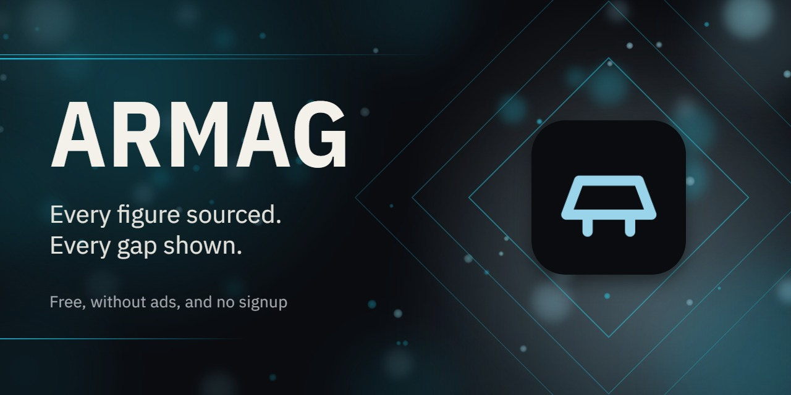

  

  

     

**ARMAG** (from _arm_ + _magazine_) is a non-profit reference for firearms. The name works twice over: a magazine is what a firearm is fed from, and a magazine is what this is, with one page per firearm, cartridge and manufacturer, laid out like a magazine rather than a database dump.

Every figure is either sourced or computed, and it always says which. A number nobody has published yet is shown as a gap rather than quietly filled in. It also does the physics, from trajectory and retained energy to recoil, and every derived number shows its formula and where each input came from. What you save stays in your own browser.

Under the hood, it is a static site built with Astro and Svelte. Every firearm, cartridge and manufacturer is structured content that a schema checks at build time: a figure marked verified without a source link, or a hedge word in a source note, stops the build. Trajectories are integrated in your browser with a Runge-Kutta solver over the public-domain G1 and G7 drag tables, validated against published ballistic tables.

## License and credits

The code is released under the [KFA Source-Available License 1.0](LICENSE). It is **source-available, not open source**: you can read it, fork it and run it privately, but deploying it, modifying it and commercial use need written permission.

Third-party software, data and media are credited in [THIRD_PARTY.md](THIRD_PARTY.md).

---

© 2026 Kiarash Farajzadehahary.

Made with ❤️ for those who respect every round.
